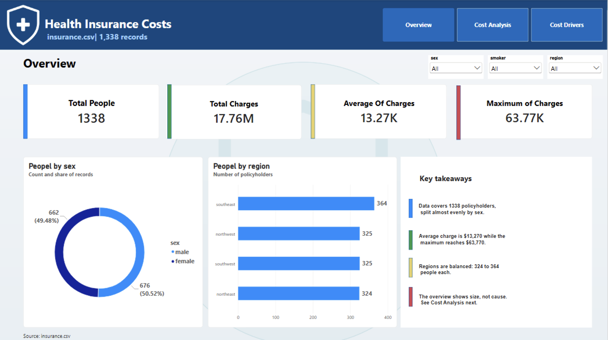
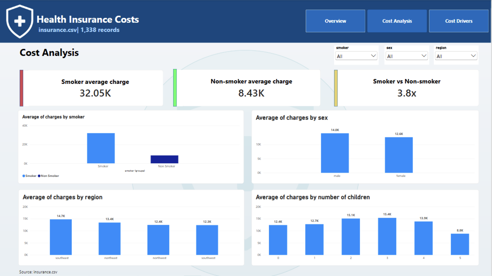
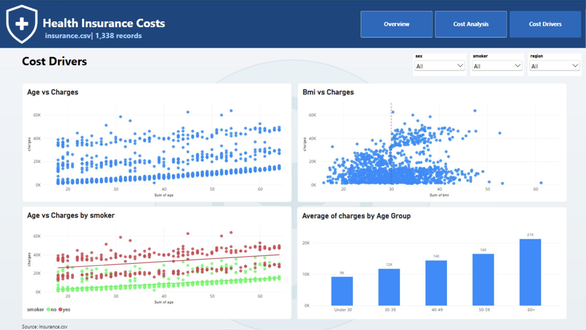

# Health Insurance Costs Dashboard (Power BI)

An interactive three-page Power BI dashboard that explores what is associated with higher medical insurance charges, built from the public `insurance.csv` dataset.

**Question:** how do insurance charges differ across groups, and which factors are associated with higher costs?

## Dashboard preview

| Overview | Cost Analysis | Cost Drivers |
|---|---|---|
|  |  |  |

## Dataset

Public dataset with **1,338 records** and 7 columns:

| Column | Description |
|---|---|
| `age` | Age of the policyholder |
| `sex` | Male / female |
| `bmi` | Body mass index |
| `children` | Number of dependents |
| `smoker` | Smoker or non-smoker |
| `region` | US region (northeast, northwest, southeast, southwest) |
| `charges` | Individual medical insurance charges (USD) |

Source: the commonly used "Medical Cost Personal" insurance dataset (add the link you downloaded it from).

## Dashboard pages

All three pages have slicers for **sex**, **smoker** and **region**, and a navigation bar to switch between pages.

1. **Overview** - dataset size and overall cost level.
   - KPI cards: total people (1,338), total charges (17.76M), average charge (13.27K), maximum charge (63.77K).
   - Donut chart: people by sex (male 676 / 50.52%, female 662 / 49.48%).
   - Bar chart: people by region (southeast 364, northwest 325, southwest 325, northeast 324).
   - A "Key takeaways" panel summarizing the page.
2. **Cost Analysis** - average charges compared across groups.
   - KPI cards: smoker average charge (32.05K), non-smoker average charge (8.43K), and the smoker vs non-smoker ratio (3.8x).
   - Average charges by smoker status, sex, region and number of children.
3. **Cost Drivers** - relationship between age, BMI, smoking and charges.
   - Age vs charges scatter plot.
   - BMI vs charges scatter plot, with a reference line at BMI 30.
   - Age vs charges colored by smoker status, with a trend line for each group.
   - Average charges by age group (Under 30, 30-39, 40-49, 50-59, 60+).

## Key findings

- The dataset covers 1,338 people, with total charges of about $17.76M, an average of about $13,270 and a maximum of about $63,770.
- The data is balanced: about 50.5% male and 49.5% female, and 324 to 364 people in each region.
- Smoking shows the largest gap: smokers' average charges are about **3.8 times** those of non-smokers (about $32.05K vs about $8.43K).
- Charges rise steadily with age: the average goes from about $9K for people under 30 to about $21K for people aged 60 and over.
- On average, smokers' charges are higher than non-smokers' at every age, and both groups rise with age.
- In the BMI chart, the highest charges (roughly $30K-$50K+) appear mostly at BMI above 30. This is a visual pattern, and it may overlap with smoking.
- Differences by sex and region are modest compared with the smoking gap:
  - Sex: male about $14.0K vs female about $12.6K.
  - Region: from about $12.3K (southwest) to about $14.7K (southeast).
- Number of children shows no clear trend: averages range from about $12.4K (0 children) to about $15.4K (3 children), and drop to about $8.8K for 5 children.

> These are associations found in this dataset, not proof of cause and effect. The data does not include health conditions or treatments, so it cannot explain *why* charges differ.

## Tools and skills

- **Power BI Desktop** - data model, visuals, slicers, page navigation
- **Power Query** - cleaning, data types, conditional `Age Group` column
- **DAX** - measures such as the smoker vs non-smoker ratio
- Dashboard design: layout, color semantics, consistent formatting

## How to use

1. Install [Power BI Desktop](https://powerbi.microsoft.com/desktop/) (free).
2. Open `Health_Insurance_Dashboard.pbix`.
3. Use the slicers and the page tabs to explore the data.

## Repository structure

```
health-insurance-dashboard/
├── README.md
├── Health_Insurance_Dashboard.pbix
├── data/
│   └── insurance.csv
└── images/
    ├── page1_overview.png
    ├── page2_cost_analysis.png
    └── page3_cost_drivers.png
```

## Author

**Mahmood Naji**

- LinkedIn: [linkedin.com/in/mahmoodnaji](https://www.linkedin.com/in/mahmoodnaji)
- Email: mahmoodenaji2005@gmail.com
